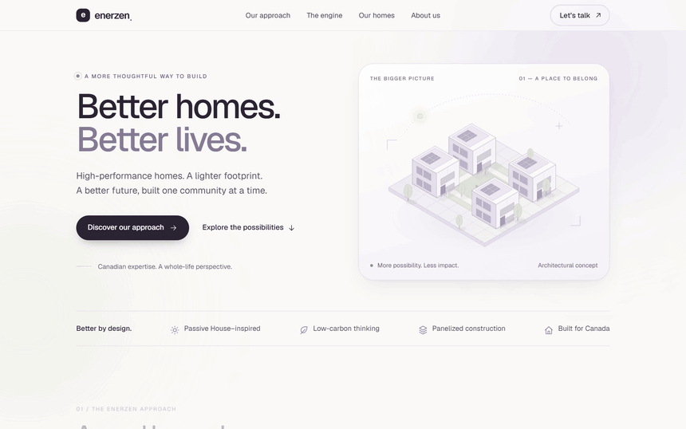
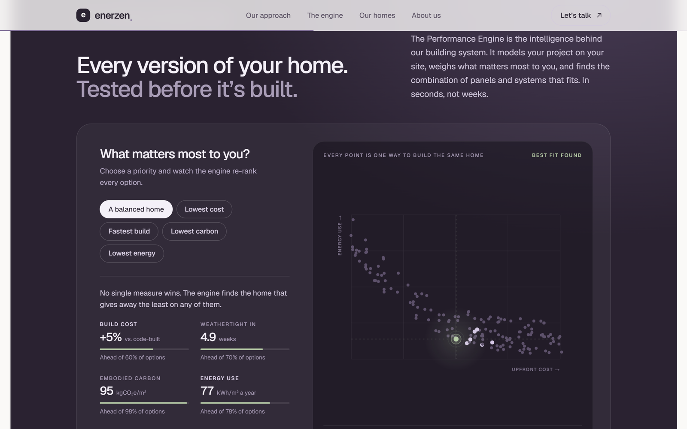
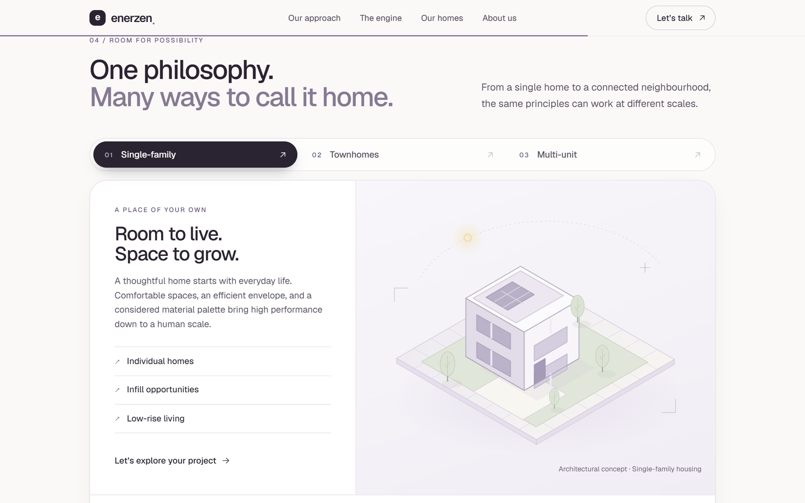

<div align="center">

# EnerZen website

**Better homes. Better lives.**<br>
The public site for EnerZen's prefabricated high-performance housing system.


**[enerzen-website.vercel.app](https://enerzen-website.vercel.app)**



</div>

## What's on it

One page, five parts, each reachable from the navigation:

| Section | What it says |
| --- | --- |
| **Our approach** | Why the homes are built the way they are: comfort, a lighter footprint, and certainty from drawing to front door. |
| **The engine** | An interactive picture of the Performance Engine: pick what matters most and watch every option re-rank. |
| **Our homes** | Single-family, townhomes and multi-unit, each with its own concept drawing. |
| **About us** | The team and their experience. |
| **Let's talk** | Where a conversation starts. |

<table>
<tr>
<td width="50%" valign="top">

**The engine, explained by using it**



</td>
<td width="50%" valign="top">

**Three scales of home**



</td>
</tr>
</table>

The engine itself lives in [enerzen-prototype](https://github.com/aaravhmodi/enerzen-prototype).

## Run it

```bash
npm install
npm run dev
```

Open http://localhost:3000. The page is `src/app/page.tsx`, built from the parts in `src/components/`, with styles in `src/app/globals.css`.

```bash
npm run build   # production build
npm run lint    # ESLint
```

## Built with

Next.js 16 (App Router), React 19, TypeScript and Tailwind CSS 4. The drawings and the engine chart are inline SVG, so there are no image or chart libraries to load. It deploys to Vercel.
